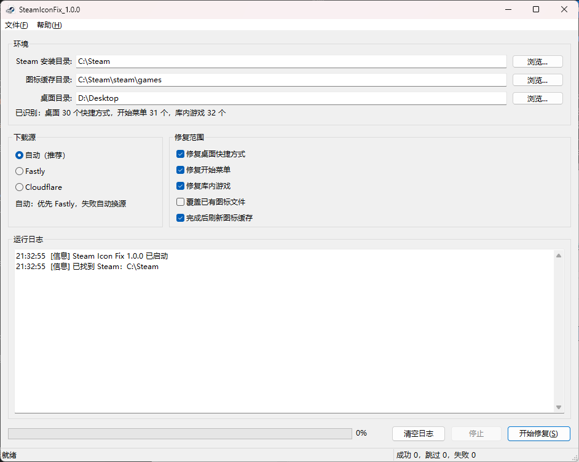

<div align="center">

<h1>Steam Icon Fix - Steam游戏图标修复工具</h1>

> 适用场景：Steam 桌面与开始菜单快捷方式显示为**空白图标**的问题


本项目从 **https://github.com/ez4y2f/SteamIconFix** 进行图形化重写。图形化界面操作更简单直观。

</div>

## ⚙️ 功能

- 自动检测 Steam 安装目录、图标缓存目录、桌面目录、开始菜单
- 扫描桌面和开始菜单里的 Steam 快捷方式，以及所有库目录下的 `appmanifest_*.acf`
- 从 Steam CDN 补全缺失的 `.ico` 图标文件，写入 `Steam\steam\games`
- 回写快捷方式的 `IconFile` 指向——很多快捷方式这一项是空的，图标文件存在也不会显示
- 三种下载源：自动（优先 Fastly，失败回退 Cloudflare）、Fastly、Cloudflare
- 支持中途停止；单个游戏失败不影响其余，连续 3 次网络失败才整体中止
- 可选的图标缓存刷新（不勾选也能生效，靠系统通知；勾选会重启 explorer.exe 彻底清缓存）



## ⬇️ 下载使用

[](https://github.com/NeetheCheeBao/SteamIconFix/releases)

## ⭐ 使用方法

1. 运行 `SteamIconFix.exe`
2. 确认「环境」里的三个路径，一般无需修改；检测指向异常时可手动指定
   - **Steam 安装目录**：从注册表读取
   - **图标缓存目录**：`<Steam 安装目录>\steam\games`
   - **桌面目录**：系统桌面，支持被重定向到其他盘
3. 选择下载源，默认「自动」即可
4. 勾选修复范围
5. 点「开始修复」，日志区会逐个输出结果，进度条和状态栏同步显示

修复完成后会弹出统计：成功、跳过、失败，以及修正了多少个快捷方式的指向。

菜单里的「文件 → 刷新环境」可以重新扫描（快捷键 `Ctrl+R`）。

## 💫 实现说明

### ❓ 图标从哪来

Steam 的图标文件名是 `clienticon` 字段的哈希值，实际文件是 `<哈希>.ico`。程序先看快捷方式里记的 `IconFile`，没有就去 `api.steamcmd.net` 查：

```
https://api.steamcmd.net/v1/info/<appid>   →   common.clienticon
https://shared.fastly.steamstatic.com/community_assets/images/apps/<appid>/<哈希>.ico
https://cdn.cloudflare.steamstatic.com/steamcommunity/public/images/apps/<appid>/<哈希>.ico
```

接口只返回哈希，不带扩展名，CDN 上的文件却带 `.ico`——少了这个后缀会全部 404。

### ❓ 为什么会是白图标

两种常见原因，工具都会处理：

1. `steam\games` 下缺少对应的 `.ico` 文件 → 下载补上
2. 快捷方式里的 `IconFile=` 是空的，或指向已不存在的路径 → 回写为实际文件路径

第 2 种最容易被忽略：图标文件明明在，桌面还是白的，因为快捷方式没指向它。

### ✨ 缓存刷新

改写快捷方式后会调用 `SHChangeNotify` 通知资源管理器，通常几秒内图标就会更新，不需要重启 explorer。

如果仍然不刷新，勾选「完成后刷新图标缓存」，程序会结束 `explorer.exe`、删除 `iconcache_*.db` 和 `thumbcache_*.db`、再重新启动资源管理器。桌面会闪一下，属于正常现象。

## ⭕ 已知限制

- 图标数据来自 `api.steamcmd.net` 与 Steam CDN，需要联网；第三方接口存在不可用的风险
- Steam 装在 `Program Files` 下时，写入 `steam\games` 可能需要以管理员身份运行
- 快捷方式指向的是非 Steam 应用（`URL` 不是 `steam://`）时会被忽略
- 极少数应用在接口里没有 `clienticon` 字段（工具类、测试分支等），会被跳过

## 🛠️ 本地构建

### 🔨 一键编译（推荐）

- 环境：MinGW-w64

1. 克隆仓库

```bash
git clone https://github.com/NeetheCheeBao/SteamIconFix.git
```

```bash
gh repo clone NeetheCheeBao/SteamIconFix
```

2. 一键编译

```bash
.\build.bat
```

产物 `bin\SteamIconFix.exe`。中间文件 `%TEMP%\SteamIconFix_build`，链接完成后自动清理

### ⛏️ CMake

```
cmake -S . -B build -G "MinGW Makefiles"
cmake --build build
```

## 📂 项目结构

```text
SteamIconFix
|   .gitignore
|   build.bat             # 一键编译脚本
|   CMakeLists.txt        # CMake 构建配置
|   LICENSE
|   README.md
|   version.ini           # 版本号
|
+---res
|       app.ico           # 应用图标
|       app.manifest      # DPI 与公共控件声明
|       app.rc            # 菜单、快捷键、图标资源
|       resource.h        # 资源与控件 ID
|
+---screenshot
|       demo1.png         # 截图
|
\---src
    |   core.h            # 核心层对外接口
    |   main.cpp          # 入口与消息分发
    |
    +---core
    |       Env.cpp       # 快捷方式与库扫描
    |       Env.h         # 对应声明
    |       Fix.cpp       # 下载流程与缓存刷新
    |       Net.cpp       # WinHTTP 与 JSON 取值
    |       Net.h         # 对应声明
    |       Util.cpp      # 路径、注册表等工具
    |
    \---ui
            Actions.cpp   # 环境读取、开始修复
            App.cpp       # 控件创建与布局
            App.h         # 界面状态与声明
```

## ⚖️ 许可证

本项目采用 GNU General Public License v3.0 许可证 - 详情请参阅 [LICENSE](LICENSE) 文件